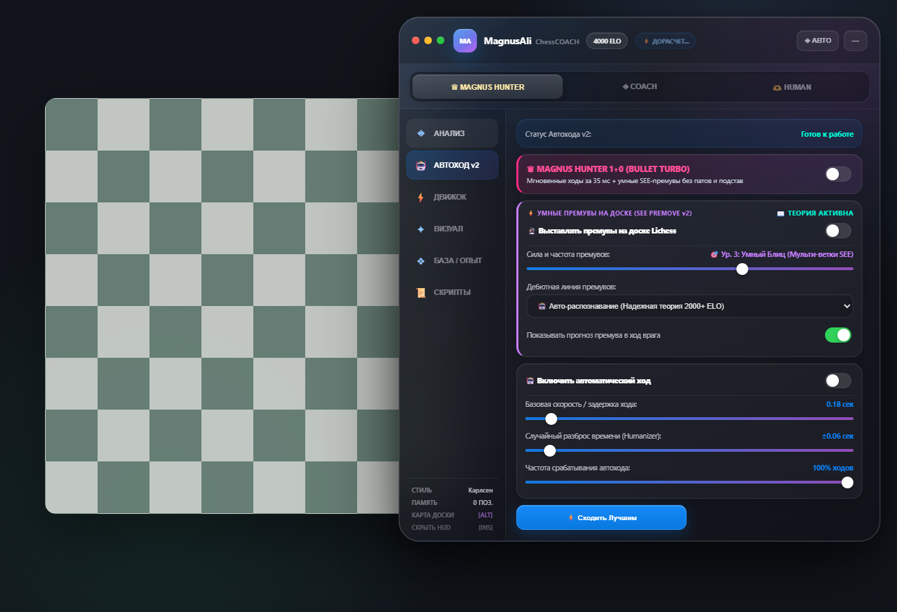

# ♟️ MagnusAli ChessCOACH 16.1 — Apple Glass & Adaptive 4000



## Возможности

- Stockfish 19 в отдельном WebWorker с профилями силы `400–4000 ELO`.
- Быстрый локальный проход, глубокая проверка, Lichess Cloud и таблицы Syzygy до 7 фигур.
- Автоматическая оценка рейтинга соперника и максимальный режим против уровня 3000+.
- Human-тайминг: разные паузы для дебюта, форсированных взятий, тактики, блица и цейтнота.
- Проверяемая Stockfish попытка детского мата против соперника до 1200.
- WDL, график оценки, угрозы, тепловая карта, объяснения ходов и дебютная база.
- Apple Glass GUI с macOS-шапкой, сегментированными режимами, системными контролами, пользовательским фоном и сохранением позиции окна.
- Конфиги `.chess`, Experience DB и MagnusAli ChessCOACH SDK (`window.MagnusAliChessCOACH`, совместимый алиас `window.CC`).

## Режим 4000

Профиль **Magnus Hunter** использует максимальный Skill Level Stockfish, Hash 96 MB, отключённое ограничение силы и увеличенный бюджет глубокого поиска. В обычной позиции расчёт получает до 3.2 секунды, в тактически опасной — больше. При нехватке времени бюджет автоматически сокращается.

Число `4000 ELO` обозначает максимальный профиль настроек движка. Фактическая игровая сила зависит от процессора, доступного времени и позиции.

## Детский мат

Линия активируется, когда:

1. определён рейтинг соперника `≤ 1200`;
2. игра идёт белыми и позиция ещё в дебюте;
3. кандидат `e4`, `Bc4`, `Qh5` или `Qxf7#` найден среди линий Stockfish;
4. потеря оценки не превышает 0.70 пешки, а форсированный мат получает безусловный приоритет.

Если соперник защищается корректно, план автоматически отменяется и выбирается обычная сильнейшая линия.

## Структура

```text
MagnusAli-ChessCOACH/
├── manifest.json
├── background/background.js
├── content/
│   ├── content.js
│   ├── chesscom.js
│   ├── content.css
│   └── main-bridge.js
├── lib/
│   ├── magnusali-core.js
│   ├── stockfish-local.js
│   ├── openings.js
│   ├── explainer.js
│   ├── phonk-fx.js
│   └── script-api.js
├── scripts/sample.js
└── MAGNUSALI_CHESSCOACH_API.md
```

## Установка

1. Откройте страницу расширений браузера.
2. Включите режим разработчика.
3. Выберите **Загрузить распакованное расширение**.
4. Укажите эту папку — `manifest.json` должен лежать в её корне.

После изменения файлов нажмите **Обновить** на карточке расширения.
