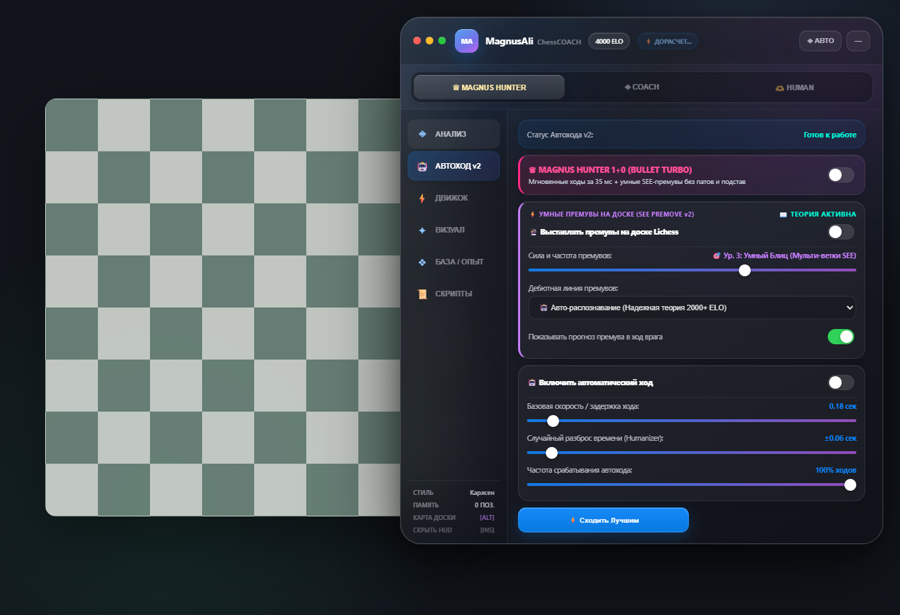

# ♟️ MagnusAli ChessCOACH v16.1

**MagnusAli ChessCOACH** — браузерный шахматный тренер с локальным Stockfish 19, Syzygy, понятными объяснениями и адаптивным интерфейсом для Lichess и Chess.com.

## Что нового в v16

- **Magnus Hunter 4000** — отдельный глубокий проход Stockfish 19, увеличенный Hash и ожидание окончательного результата перед автоматическим ходом.
- **Адаптация под соперника** — рейтинг читается из интерфейса площадки; против игрока 3000+ автоматически включается максимальный расчёт.
- **Human-профиль** — темп зависит от часов, сложности позиции, взятий, дебютной стадии и тактических мотивов.
- **Безопасная попытка детского мата** — для соперников до 1200 выбираются `e4`, `Bc4`, `Qh5`, `Qxf7#`, только если ход присутствует в MultiPV Stockfish и не ухудшает позицию.
- **Apple Glass GUI** — настоящее стеклянное окно с macOS-шапкой, сегментированными режимами, системными переключателями, мягким блюром и адаптивной компоновкой.
- **Обновлённый бренд** — manifest, HUD, SDK, конфиги и документация используют название MagnusAli ChessCOACH.

## Установка

1. Откройте `chrome://extensions/` или `edge://extensions/`.
2. Включите **Режим разработчика**.
3. Нажмите **Загрузить распакованное расширение**.
4. Выберите папку `MagnusAli-ChessCOACH`, в которой находится `manifest.json`.
5. Откройте шахматную доску на Lichess или Chess.com.

## Профили

| Профиль | Назначение |
|---|---|
| **♛ Magnus Hunter** | Максимальная сила, Stockfish 19, Syzygy, 4000 ELO |
| **◈ Coach** | Все инструменты анализа и тонкие настройки |
| **🫶 Human** | Естественный ритм, вариативные сильные линии и мягкие паузы |

## Горячие клавиши

- `Insert` — скрыть или показать HUD.
- `Alt` — временно показать тепловую карту.
- `X` на Chess.com — выполнить один выбранный ход.
- `Esc` — остановить визуальный эффект.

Техническая документация находится в `MagnusAli-ChessCOACH/README.md` и `MagnusAli-ChessCOACH/MAGNUSALI_CHESSCOACH_API.md`.
